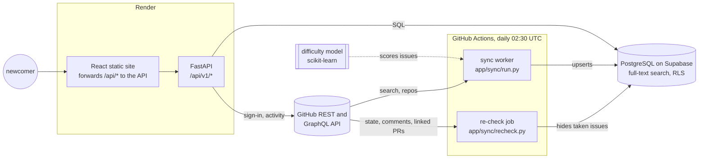

# FirstPR

**Find open-source issues you can actually fix: open, unclaimed, in active repos, with an honest difficulty estimate.**

**Live demo:** https://firstpr.pages.dev · **API docs:** https://firstpr-api-5lk3.onrender.com/docs · **Numbers:** [stats page](https://firstpr.pages.dev/stats)

> Hosted on Render's free tier: if the site has been idle, the first search can take ~50 s while the API wakes up.


<sub>Recorded from the live site with a script (<code>frontend/scripts/record-demo.mjs</code>), so it can be re-recorded when the UI changes.</sub>

---

## Why

Sites like goodfirstissue.dev list issues that carry a `good first issue` label. In practice, many of those issues have already been claimed, sit in repos nobody maintains, or turn out to be far harder than the label suggests. FirstPR keeps its own synced index of these issues and filters out the ones that are no longer available. It also scores each issue so you can see why it was ranked where it is.

## What it does

- **Search and filter** by language, difficulty, stars, freshness and full text. Every filter is in the URL, so a search can be shared.
- **Hide issues you can't take**: closed, assigned, claimed in a comment ("I'll take this"), already linked to a PR, or no longer labelled. A daily re-check keeps this current.
- **Estimate difficulty** with a model trained on 2,633 past issues, labelled by the size of the PRs that closed them. It shows its confidence and reasons ([evaluation](ml/EVAL.md)).
- **Score repo health** from 0 to 100 (recent pushes, stars, forks, a contributing guide), with the points for each shown.
- **Sign in with GitHub** to get a *For you* list ranked by the languages and experience your public GitHub activity shows, and to track issues from Saved → Working on it → PR opened → Merged.
- **Show the numbers** on a public [stats page](https://firstpr.pages.dev/stats): index size, sync freshness, recent runs, and the model against its baselines.

## Status

Built on a four-week plan (see [`docs/blueprint.md`](docs/blueprint.md)).

| Area | State |
| --- | --- |
| Postgres schema + Alembic migrations, Row Level Security on every table (Supabase) | ✅ done |
| GitHub client: search, repo fetch, rate-limit handling, ETags, retries | ✅ done |
| Sync worker: date-window splitting past GitHub's 1,000-result cap, idempotent upserts | ✅ done |
| Real data: 4,600+ open issues from 2,400+ repos in 10 languages, synced daily | ✅ done |
| Re-check job: hides closed, assigned, claimed, linked-PR and de-labelled issues | ✅ done |
| Difficulty model: beats both baselines on held-out issues ([evaluation](ml/EVAL.md)) | ✅ done |
| Repo health score, Explore by level and type, a first-PR guide | ✅ done |
| Search indexes chosen with `EXPLAIN ANALYZE` ([before/after](perf/INDEXES.md)) | ✅ done |
| Sign in with GitHub (OAuth, encrypted tokens, server-side sessions) | ✅ done |
| Saved issues with status tracking; "For you" ranking with reasons | ✅ done |
| Public stats page: index counts, sync freshness, model vs baselines | ✅ done |
| Tests: 199 backend (87% coverage), Vitest components, a Playwright flow, all in CI | ✅ done |
| Load test: 50 users for 2 min, search p95 250 → 92 ms with indexes ([k6 results](perf/LOAD_TEST.md)) | ✅ done |
| Docker, Render deploy, CI, daily sync workflow, structured logs, `/health`, Sentry | ✅ done |

## Architecture



**Search never calls GitHub.** Requests are answered from our own Postgres. That keeps search fast, means GitHub's rate limits only affect the background jobs, and lets us filter on things GitHub search can't, like availability and difficulty. GitHub is called live only to sign someone in and read their public activity.

## Tech stack

- **Backend:** Python 3.12, FastAPI, SQLAlchemy 2, Alembic, httpx, Pydantic
- **Database:** PostgreSQL on Supabase (full-text search, array labels, JSONB); local Postgres for tests
- **Frontend:** React 19, TypeScript, Vite, Tailwind CSS, TanStack Query; types generated from the API's OpenAPI schema
- **ML:** scikit-learn (logistic regression), pandas; time-based train/test split
- **Testing:** pytest + respx (recorded GitHub responses), Vitest + Testing Library, Playwright, k6
- **Ops:** Docker, Render, GitHub Actions (CI and the daily sync), JSON logs, Sentry

## Results

All measured. Index numbers are from the live [stats page](https://firstpr.pages.dev/stats) on 2026-11-17.

| Metric | Value |
| --- | --- |
| Open issues indexed | 4,647 (4,454 still available) |
| Repos indexed | 2,463 |
| Search p95 under load, 50 users on 200k issues (before → after indexes) | 250 ms → 92 ms ([how](perf/LOAD_TEST.md)) |
| Difficulty accuracy on 658 held-out issues: model / always "hard" / heuristic | 40.6% / 38.0% / 30.4% |
| Severe errors (easy↔hard), model vs heuristic | 14.4% vs 22.5% |
| Backend test coverage | 87% (199 tests) |

## Design decisions

- **Serve from our own database, not live GitHub calls.** Search stays fast and predictable, and rate limits only affect the background sync, never users.
- **Split search queries into date windows.** GitHub search returns at most 1,000 results per query, so the sync halves a window's date range until each piece fits under the cap.
- **Every write is an upsert, and each page is committed separately.** A crashed sync can simply be run again, and it loses at most one page of work.
- **ETags on repo fetches.** If a repo hasn't changed, GitHub replies `304 Not Modified`, and that reply doesn't count against the rate limit.
- **Row Level Security with no policies on every table.** Supabase publishes the `public` schema through an API anyone can call with the public key. With RLS on and no policies, that API returns nothing. Our backend connects as the table owner, so it isn't affected.
- **Train on older issues, test on newer ones.** A random split would let the model learn from the future. [EVAL.md](ml/EVAL.md) reports the model next to both baselines, including always guessing "hard", which it beats by only 2.6 points.
- **Explainable over clever.** Health, difficulty and *For you* matches all come with reasons ("Python, your main language", "Healthy, active repo"), because a newcomer has no reason to trust a bare number.
- **Server-side sessions, stored as a hash.** The cookie is HttpOnly, Secure and SameSite=Lax; the database stores only its SHA-256, so a leaked database can't be used to sign in. GitHub tokens are encrypted with Fernet.
- **Migrations run when the API starts.** New code can never meet an old schema (see the outage below). That's safe with one instance; with several it would become a separate pre-deploy step.
- **Monitoring that can't leak secrets.** Sentry is off without a DSN. When it's on, it gets no cookies, no auth headers, no OAuth query strings and no stack-frame variables. A test sends a crash with a session cookie and checks the cookie isn't anywhere in the report.

## What broke and how I fixed it

**The live site went down after a deploy (2026-11-15).** I shipped the Explore-by-level feature, whose code read two new columns, `level` and `kind`. Render deployed the code within minutes, but migrations only ran with the nightly sync, so the API queried columns that didn't exist yet and searches failed. The site came back as soon as I ran `alembic upgrade head` against Supabase. The permanent fix: the API container now runs migrations before it starts serving, so a deploy can't get ahead of the database again.

**All the training data came from one week.** The first collection run for the difficulty model returned 549 examples, but grouping them by month showed they were all from the same few days. The collector gave each 30-day search window *the whole remaining budget*, so the first window used it all. Each window now gets an equal share, and a quiet month passes what it can't use on to the next. Without that check, the time-based test split would have been testing on almost nothing.

**Real GitHub data broke the sync three different ways.** One response came back as `200 OK` with its JSON cut off mid-transfer. One issue body contained a NUL character, which Postgres refuses to store in text and JSONB. And a single `502` from GitHub for one month stopped a whole multi-hour run. Each one is now handled: truncated JSON is retried like a network error, NUL characters are stripped, and a failed window is logged and skipped. Each has a test that replays the exact case from real data.

**A monitoring test caught a leak.** When I added Sentry, I wrote a test that crashes a route while signed in, then searches the error report for the session cookie. It found the cookie: Sentry attaches every stack frame's local variables by default, and the request headers sit in those variables. In the sign-in code, they would also have included the user's decrypted GitHub token. Frame variables are now switched off and stripped again before sending, and that test runs in CI.

## Local setup

Prerequisites: Python 3.12+, Node 22 and PostgreSQL 16 binaries installed locally. Docker is optional (see below).

```bash
# 1. Clone
git clone https://github.com/Shadab-4123/FirstPR.git
cd FirstPR

# 2. Start a project-local Postgres on port 5433 (creates the firstpr, firstpr_test and firstpr_e2e DBs)
scripts/dev-db.sh start

# 3. Backend environment
cd backend
python3 -m venv .venv
source .venv/bin/activate
pip install -e ".[dev]"

# 4. Config: copy the example and add a GitHub token (see below)
cp .env.example .env

# 5. Create the tables
alembic upgrade head

# 6. Load sample data (~200 Python issues)
python -m app.sync.run --language python --limit 200

# 7. Run the API → http://localhost:8000/docs
uvicorn app.main:app --reload

# 8. In a second terminal: the frontend → http://localhost:5173
cd frontend
npm install
npm run dev
```

### Or: everything in Docker

With Docker installed, one command runs Postgres, the API and the frontend. It uses its own database, not Supabase.

```bash
cp backend/.env.example backend/.env   # add GITHUB_TOKEN
docker compose up --build              # app → http://localhost:8080, API → http://localhost:8000/docs
docker compose run --rm sync           # load ~200 Python issues into the Docker DB
```

### Deploying

[`render.yaml`](render.yaml) is a Render Blueprint: the API runs as a Docker web service and the frontend as a static site that forwards `/api/*` to it. The database stays on Supabase. In Render, go to New → Blueprint, pick this repo, and enter the secrets when asked. The API applies pending migrations each time it starts.

**Database:** `DATABASE_URL` in `backend/.env` points at Supabase. Use the *Session pooler* connection string (IPv4, port 5432), with the `postgresql+psycopg://` prefix and `?sslmode=require`. URL-encode special characters in the password. Tests always use the local databases from step 2, never Supabase.

**GitHub token:** create a [fine-grained personal access token](https://github.com/settings/personal-access-tokens) with public-repository read-only access. It needs no extra permissions. Put it in `backend/.env` as `GITHUB_TOKEN=...`. Without a token the sync still runs, but GitHub allows only 60 requests per hour.

**GitHub sign-in:** create an OAuth App (GitHub → Settings → Developer settings) with the callback URL `{APP_URL}/api/v1/auth/github/callback`, then set `GITHUB_CLIENT_ID`, `GITHUB_CLIENT_SECRET` and `TOKEN_ENCRYPTION_KEY` (see `backend/.env.example`). The API logs at startup which of these are missing.

**Error monitoring (optional):** create two Sentry projects, one FastAPI and one React. Put the first DSN in `SENTRY_DSN` (the Render API service, and a `SENTRY_DSN` secret in GitHub for the sync workflow). Put the second in `VITE_SENTRY_DSN` on the Render static site. Without them nothing is sent, and the browser never downloads the Sentry SDK.

**API types:** after changing a backend response model, regenerate the frontend types:

```bash
cd backend && python -c "import json, pathlib; from app.main import app; pathlib.Path('../frontend/openapi.json').write_text(json.dumps(app.openapi(), indent=2) + '\n')"
cd ../frontend && npm run gen:api
```

### Running tests

```bash
cd backend && source .venv/bin/activate
pytest --cov=app  # GitHub calls are replayed from recorded fixtures; tests use the firstpr_test DB
ruff check . && mypy app

cd ../frontend
npm test          # Vitest: components and helpers, with fetch mocked
npm run e2e       # Playwright: production build + real API + the firstpr_e2e DB, in Chromium
```

`npm run e2e` starts its own API and site, applies migrations to `firstpr_e2e`, and loads the test fixtures there. Run `npx playwright install chromium` once first. The load test is in [`perf/`](perf/LOAD_TEST.md).

## API

All endpoints live under `/api/v1`. Interactive docs are at [`/docs`](https://firstpr-api-5lk3.onrender.com/docs).

| Method | Path | Purpose |
| --- | --- | --- |
| GET | `/issues` | Search and filter issues (paginated) |
| GET | `/issues/{id}` | One issue with its difficulty, health and availability details |
| GET | `/meta/filters`, `/meta/levels` | Languages, labels and counts for the filter UI and Explore |
| GET | `/stats` | Index counts, sync runs, model results |
| GET | `/health` | Liveness and database check |
| GET | `/auth/github/login`, `/auth/github/callback` | Sign in with GitHub |
| GET, POST | `/auth/me`, `/auth/logout` | The signed-in user; sign out |
| GET | `/me/recommended` | *For you*: issues ranked by your languages and level, with reasons |
| POST | `/me/profile/refresh` | Re-read your public GitHub activity |
| GET, PUT, DELETE | `/me/saved`, `/me/saved/{issue_id}` | Saved issues and their status |

`GET /issues` query parameters: `language`, `labels`, `min_stars`, `difficulty` (easy / medium / hard), `level` (new / some / experienced), `kind`, `available_only` (default `true`), `updated_within_days`, `q` (full-text search), `sort` (relevance / newest / updated / stars), `page`, `page_size` (max 50).

Errors always use the same shape: `{ "error": { "code": "...", "message": "..." } }`.

## Known limitations and future work

- **Free hosting.** The API sleeps after ~15 minutes idle (first request ~50 s), runs on a fraction of a CPU, and sits in Singapore while the database is in Mumbai. The load test measures the code, not this hosting.
- **The "N issues found" count** is most of a search's database time at large sizes ([details](perf/LOAD_TEST.md)). Capping it ("1,000+") is the next speed-up if it's needed.
- **The difficulty model** is right 41% of the time across three bands, only a little better than always guessing "hard". Its real gain is fewer easy↔hard mix-ups, which is why the UI shows it as an estimate with confidence and reasons.
- **Skill inference** only sees public activity. Someone whose work is in private repos looks like a beginner.

## Author

<!-- TODO(you): add your LinkedIn and write-up links -->
Built by **Shadab Raza** · GitHub: [Shadab-4123](https://github.com/Shadab-4123) · LinkedIn: TODO · Write-up: TODO

## License

<!-- TODO(you): pick one (MIT is common for portfolio projects) and add a LICENSE file. -->
TODO
