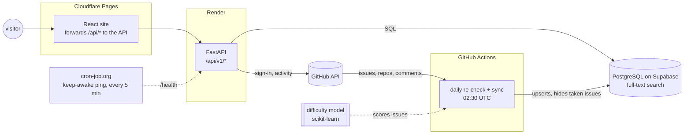

# FirstPR

**Find open-source issues you can actually fix: open, unclaimed, in active repos, with an honest difficulty estimate.**

**Live site:** https://firstpr.pages.dev · **API docs:** https://firstpr-api-5lk3.onrender.com/docs


## Why

Getting hired is hard right now, for freshers and experienced developers alike, and more and more companies ask for open-source contributions as proof that you can work in a real codebase with real reviewers. The usual advice is "find an issue labelled `good first issue` and start there". In practice:

- **Many of those issues are already taken.** Someone commented "I'll take this" weeks ago, or a pull request is already open.
- **Many sit in repos nobody maintains.** A pull request there may never be reviewed.
- **Many are harder than the label says.** The "easy" issue turns out to need changes across a dozen files.

Sites like goodfirstissue.dev just repeat GitHub's labels. FirstPR keeps its own synced copy of these issues, hides the ones that are no longer available, and scores each one, with reasons, so you can see why it's ranked where it is. The goal: spend your time on a first contribution that can actually get merged.

## What it does

- **Search and filter** by language, difficulty, stars, freshness and full text. Every filter is in the URL, so a search can be shared.
- **Hide issues you can't take**: closed, assigned, claimed in a comment ("I'll take this"), already linked to a PR, or no longer labelled. A daily re-check keeps this current.
- **Estimate difficulty** with a model trained on 2,633 past issues, labelled by the size of the PRs that closed them. It shows its confidence and reasons ([evaluation](ml/EVAL.md)).
- **Score repo health** from 0 to 100 (recent pushes, stars, forks, a contributing guide), with the points for each shown.
- **Explore by level**: issues grouped for people who are new to open source, have some experience, or are experienced.
- **Sign in with GitHub** to get a *For you* list ranked by the languages and experience your public GitHub activity shows, to track issues from Saved → Working on it → PR opened → Merged, and to see your contribution graph.
- **Show the numbers** on a public [stats page](https://firstpr.pages.dev/stats): index size, sync freshness, recent runs, and the model against its baselines.

## Architecture



Searches are answered from our own Postgres, never from GitHub live: the daily jobs keep the copy fresh, so search stays fast and GitHub's rate limits only affect the background jobs.

## Tech stack

- **Backend:** Python 3.12, FastAPI, SQLAlchemy 2, Alembic, PostgreSQL
- **Frontend:** React 19, TypeScript, Vite, Tailwind CSS, TanStack Query
- **ML:** scikit-learn
- **Tests:** pytest, Vitest, Playwright

## Project structure

```
backend/    FastAPI app, sync jobs (app/sync), ML (app/ml), migrations, tests
frontend/   React app, Playwright tests (e2e/)
ml/         trained difficulty model and its evaluation
perf/       index benchmarks and the k6 load test
scripts/    dev-db.sh: a local Postgres for development and tests
```

## Run it locally

You need **Python 3.12+**, **Node 22** and **PostgreSQL 16** installed.

```bash
# 1. Clone
git clone https://github.com/Shadab-4123/FirstPR.git
cd FirstPR

# 2. Start a local Postgres on port 5433 (creates the dev and test databases)
scripts/dev-db.sh start

# 3. Backend
cd backend
python3 -m venv .venv
source .venv/bin/activate
pip install -e ".[dev]"
cp .env.example .env          # then add GITHUB_TOKEN (see below)
alembic upgrade head          # create the tables
python -m app.sync.run --language python --limit 200   # load ~200 sample issues
uvicorn app.main:app --reload # API → http://localhost:8000/docs

# 4. Frontend, in a second terminal
cd frontend
npm install
npm run dev                   # site → http://localhost:5173
```

**GitHub token:** create a [fine-grained personal access token](https://github.com/settings/personal-access-tokens) with public-repository read-only access and put it in `backend/.env` as `GITHUB_TOKEN=...`. Without it the sync still works, but GitHub allows only 60 requests an hour.

**Sign in with GitHub (optional):** create an OAuth App (GitHub → Settings → Developer settings) with the callback URL `http://localhost:5173/api/v1/auth/github/callback`, then fill in `GITHUB_CLIENT_ID`, `GITHUB_CLIENT_SECRET` and `TOKEN_ENCRYPTION_KEY` in `backend/.env`. The comments in [`.env.example`](backend/.env.example) explain each one.

### Or run everything with Docker

```bash
cp backend/.env.example backend/.env   # add GITHUB_TOKEN
docker compose up --build              # site → http://localhost:8080, API → http://localhost:8000/docs
docker compose run --rm sync           # load ~200 sample issues
```

## Run the tests

```bash
cd backend && source .venv/bin/activate
pytest                     # uses the local test database, GitHub calls are replayed from fixtures
ruff check . && mypy app

cd ../frontend
npm test                   # component tests
npx playwright install chromium   # once
npm run e2e                # end-to-end tests in a real browser
```

## Author

Built by **Shadab Raza** · GitHub: [Shadab-4123](https://github.com/Shadab-4123)
