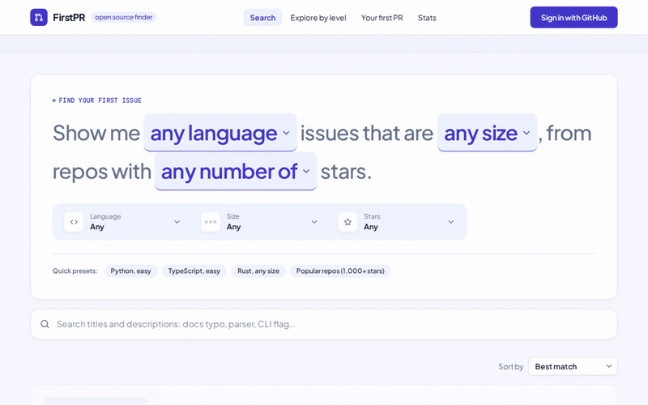
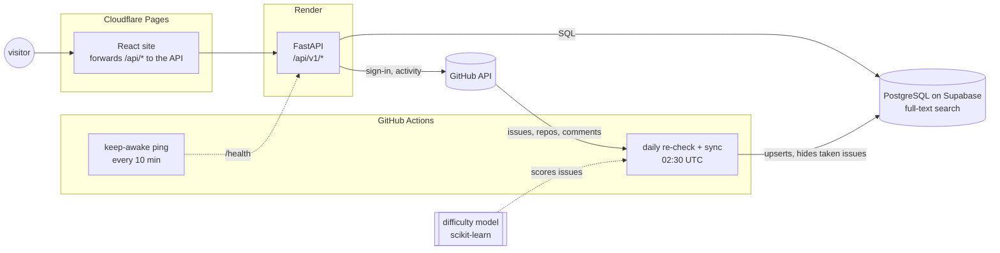

# FirstPR

**Find open-source issues you can actually fix: open, unclaimed, in active repos, with an honest difficulty estimate.**

**Live site:** https://firstpr.pages.dev · **API docs:** https://firstpr-api-5lk3.onrender.com/docs



## What it does

- **Search and filter** good-first-issues by language, difficulty, stars and text.
- **Hides issues you can't take:** closed, assigned, claimed in a comment, or already linked to a PR.
- **Estimates difficulty** with a model trained on real past issues ([evaluation](ml/EVAL.md)), and scores each repo's health.
- **Sign in with GitHub** for a *For you* list, issue tracking and your contribution graph.

## Architecture



Searches are answered from our own Postgres, never from GitHub live: the daily jobs keep the copy fresh, so search stays fast and GitHub's rate limits only affect the background jobs.

## Tech stack

- **Backend:** Python 3.12, FastAPI, SQLAlchemy 2, Alembic, PostgreSQL
- **Frontend:** React 19, TypeScript, Vite, Tailwind CSS, TanStack Query
- **ML:** scikit-learn
- **Tests:** pytest, Vitest, Playwright

## Project structure

```
backend/    FastAPI app, sync jobs (app/sync), ML (app/ml), migrations, tests
frontend/   React app, Playwright tests (e2e/)
ml/         trained difficulty model and its evaluation
perf/       index benchmarks and the k6 load test
scripts/    dev-db.sh: a local Postgres for development and tests
```

## Run it locally

You need **Python 3.12+**, **Node 22** and **PostgreSQL 16** installed.

```bash
# 1. Clone
git clone https://github.com/Shadab-4123/FirstPR.git
cd FirstPR

# 2. Start a local Postgres on port 5433 (creates the dev and test databases)
scripts/dev-db.sh start

# 3. Backend
cd backend
python3 -m venv .venv
source .venv/bin/activate
pip install -e ".[dev]"
cp .env.example .env          # then add GITHUB_TOKEN (see below)
alembic upgrade head          # create the tables
python -m app.sync.run --language python --limit 200   # load ~200 sample issues
uvicorn app.main:app --reload # API → http://localhost:8000/docs

# 4. Frontend, in a second terminal
cd frontend
npm install
npm run dev                   # site → http://localhost:5173
```

**GitHub token:** create a [fine-grained personal access token](https://github.com/settings/personal-access-tokens) with public-repository read-only access and put it in `backend/.env` as `GITHUB_TOKEN=...`. Without it the sync still works, but GitHub allows only 60 requests an hour.

**Sign in with GitHub (optional):** create an OAuth App (GitHub → Settings → Developer settings) with the callback URL `http://localhost:5173/api/v1/auth/github/callback`, then fill in `GITHUB_CLIENT_ID`, `GITHUB_CLIENT_SECRET` and `TOKEN_ENCRYPTION_KEY` in `backend/.env`. The comments in [`.env.example`](backend/.env.example) explain each one.

### Or run everything with Docker

```bash
cp backend/.env.example backend/.env   # add GITHUB_TOKEN
docker compose up --build              # site → http://localhost:8080, API → http://localhost:8000/docs
docker compose run --rm sync           # load ~200 sample issues
```

## Run the tests

```bash
cd backend && source .venv/bin/activate
pytest                     # uses the local test database, GitHub calls are replayed from fixtures
ruff check . && mypy app

cd ../frontend
npm test                   # component tests
npx playwright install chromium   # once
npm run e2e                # end-to-end tests in a real browser
```

## Author

Built by **Shadab Raza** · GitHub: [Shadab-4123](https://github.com/Shadab-4123)
